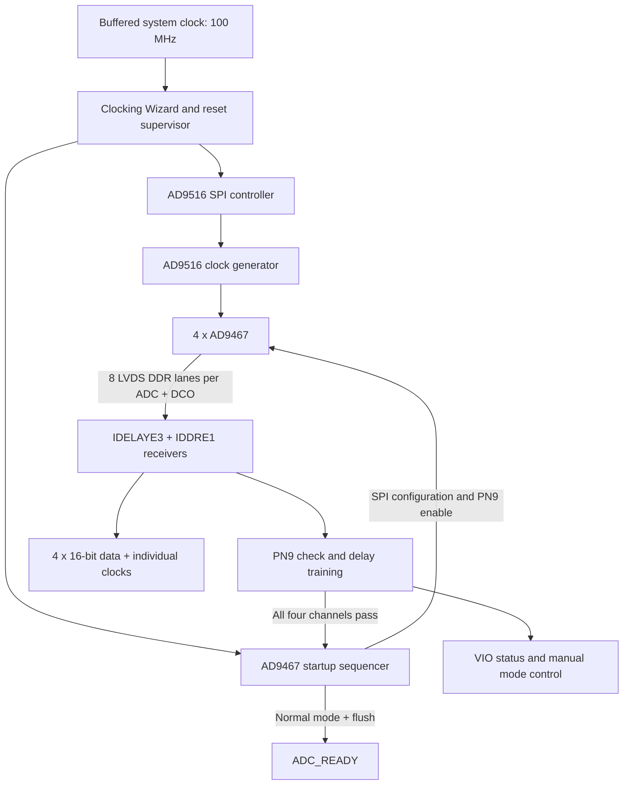

# AD9467 FPGA Interface — SPI, PN9 Training & AD9516 Clock Setup

**راه‌اندازی چهار ADC، تنظیم کلاک‌ساز و اعتبارسنجی مسیر داده در FPGA**

[Ramin Chegini · رامین چگینی](https://github.com/ramin-chegini)

این پروژه یک نمونه‌کار HDL برای نمایش مهارت در راه‌اندازی ADC پرسرعت است: تنظیم رجیسترهای **AD9467** و **AD9516** با SPI، دریافت دادهٔ LVDS به روش DDR، بررسی الگوی **PN9** و پیدا کردن تأخیر مناسب ورودی‌ها. منطق راه‌اندازی در FPGA اجرا می‌شود و برای این توالی به پردازندهٔ خارجی نیاز ندارد.

تمرکز نسخهٔ فعلی، رابط خام چهار کانال است. ماژول اصلی `ADC_orihard` نام دارد و کدهای فعال آن با VHDL نوشته شده‌اند. نسخه‌های قبلی و بلوک‌های جانبی نیز در پوشهٔ HDL مشخص شده‌اند.

## مهارت‌های قابل بررسی در کد

| حوزه | پیاده‌سازی قابل بررسی |
|---|---|
| راه‌اندازی تراشه | ترتیب ریست، انتظار برای آماده شدن کلاک و نوشتن رجیسترها |
| SPI | فریم ۲۴ بیتی، ارسال MSB-first و مدیریت CS و SCLK |
| دریافت داده | تبدیل هشت خط DDR هر ADC به کلمهٔ ۱۶ بیتی با `IDDRE1` |
| تست PN9 | پیش‌بینی کلمهٔ بعدی و رد دادهٔ خراب یا ورودی ثابت |
| کالیبراسیون | جست‌وجوی شش حالت بازسازی و انتخاب مرکز پنجرهٔ معتبر تأخیر |
| تنظیم خطوط | تنظیم مستقل تأخیر هر خط در صورت شکست جست‌وجوی مشترک |
| چند دامنهٔ کلاک | همگام‌سازی وضعیت‌ها و آزادسازی محلی ریست |
| مدیریت خطا | timeout آموزش و جلوگیری از اعلام آماده بودن در صورت شکست |
| اعتبارسنجی | تست‌های خودکار دارای assertion برای مسیر سالم و حالت‌های خطا |

## معماری



هر ADC با DCO خودش دریافت و آموزش داده می‌شود. این کالیبراسیون، صحت بازسازی کلمهٔ هر گیرنده را بررسی می‌کند؛ هم‌فاز بودن نمونه‌های چهار ADC را تضمین نمی‌کند.

## ساختار مخزن

```text
AD9467/
├── README.md                       # معرفی و راهنمای شروع
├── docs/
│   └── BRINGUP.md                  # راهنمای عملی راه‌اندازی و بررسی وضعیت
├── HDL/
│   ├── README.md                   # تفکیک فایل‌های فعال و نسخه‌های قبلی
│   ├── ADC_orihard.vhd              # ماژول اصلی و گیرنده‌های چهار کانال
│   ├── M_AD9516_Ctrl.vhd            # تنظیم کلاک‌ساز با SPI
│   ├── ad9467_startup.vhd           # توالی تنظیم و راه‌اندازی ADC
│   ├── adc_training_pkg.vhd         # توابع PN9 و بازسازی داده
│   ├── adc_pn9_trainer.vhd          # آموزش مشترک و تنظیم مستقل خطوط
│   ├── adc_idelay_loader.vhd        # کنترل تأخیر ورودی‌ها
│   ├── ADC_ALIGN_VIO.md             # جزئیات آموزش و دیباگ
│   └── tests/                      # تست‌بنچ‌ها و اسکریپت اجرا
├── Constraints/adc_align_cdc.xdc    # قیود عبور وضعیت بین دامنه‌های کلاک
├── IP/                             # IPهای ذخیره‌شدهٔ نسخهٔ اصلی پروژه
└── Prj/AD9467_ADC_Driver.xpr        # پروژهٔ اصلی Vivado 2025.2
```

خروجی‌های Vivado در `.gitignore` قرار دارند. فایل‌های منبع، پروژه و IPهای `.xcix` قابل نگهداری در گیت هستند؛ کش، لاگ و خروجی شبیه‌سازی دوباره تولید می‌شوند.

## توالی راه‌اندازی

1. ناظر کلاک از کلاک ورودی ۱۰۰ مگاهرتز اجرا می‌شود تا در صورت توقف خروجی MMCM نیز بتواند آن را ریست کند.
2. کلاک‌های داخلی ساخته می‌شوند. ریست `IDELAYE3` پیش از ریست `IDELAYCTRL` آزاد می‌شود و مدار منتظر آماده شدن بخش تأخیر می‌ماند.
3. کنترلر AD9516 جدول ۶۳ نوشتن رجیستر را ارسال می‌کند. تنظیمات جدول به برد و مدل دقیق AD9516 وابسته‌اند.
4. پس از آماده شدن شرایط کلاک و قفل AD9516، کنترلر ADC با تنظیمات پیش‌فرض ۱۰۰ میلی‌ثانیه صبر می‌کند و تنظیمات یکسان را برای هر چهار ADC می‌فرستد.
5. ADCها وارد PN9 می‌شوند. هر گیرنده، حالت بازسازی داده و تأخیر مناسب را به صورت مستقل پیدا می‌کند.
6. پس از موفقیت هر چهار کانال، ADCها به دریافت عادی با فرمت مکمل دو برمی‌گردند. پس از ۲۰۴۸ سیکل کلاک کنترل، `ADC_READY` فعال می‌شود.

نام `clk_25m` و پورت `S6_25MCLK` از نسخهٔ قبلی باقی مانده‌اند؛ فرکانس واقعی آن‌ها در این پروژه **۲۰ مگاهرتز** است. خروجی‌های دیگر Clocking Wizard برابر ۱۰۰، ۲۰۰ و حدود ۳۳۳٫۳۳۳ مگاهرتز درخواست شده‌اند؛ خروجی داخلی ۱۰۰ مگاهرتز در ماژول فعلی استفاده نمی‌شود.

## SPI و رجیسترهای کلیدی

در کنترلرهای فعال، هر فرمان شامل **۱۶ بیت دستور/آدرس + ۸ بیت داده** است. SPI مربوط به AD9467 در حالت Mode 0 اجرا می‌شود؛ با پارامتر پیش‌فرض، SCLK آن ۲٫۵ مگاهرتز است. خروجی‌های SPI چهار ADC، فرمان‌های یکسان را هم‌زمان دریافت می‌کنند.

| تراشه | رجیستر | مقدار | کاربرد در این طراحی |
|---|---|---|---|
| AD9467 | `0x14` | `0x08` | انتخاب offset binary هنگام آموزش |
| AD9467 | `0x0D` | `0x06` | فعال کردن PN9 |
| AD9467 | `0xFF` | `0x01` | اعمال تنظیمات ADC |
| AD9467 | `0x0D` | `0x00` | خاموش کردن الگوی تست |
| AD9467 | `0x14` | `0x09` | انتخاب مکمل دو برای دریافت عادی |
| AD9516 | `0x0232` | `0x01` | اعمال تنظیمات با IO_UPDATE |

جدول کامل ADC در `ad9467_startup.vhd` و جدول AD9516 در `M_AD9516_Ctrl.vhd` قرار دارد. این کنترلرها نوشتن رجیستر را انجام می‌دهند؛ بازخوانی رجیستر در مسیر فعال پیاده‌سازی نشده است. فرکانس خروجی کلاک‌ساز را باید با توجه به مرجع ورودی، مدل تراشه و تقسیم‌کننده‌های برد تعیین کرد.

انتخاب PN9 و فرمت خروجی در [دیتاشیت AD9467](https://www.analog.com/media/en/technical-documentation/data-sheets/AD9467.pdf) و کاربرد IO_UPDATE در [دیتاشیت AD9516-0، به عنوان مرجع خانواده](https://www.analog.com/media/en/technical-documentation/data-sheets/ad9516-0.pdf) شرح داده شده است. برای تغییر جدول کلاک، دیتاشیت مدل دقیق روی برد ملاک است.

## تست PN9 چگونه کار می‌کند؟

تابع `pn9_next` از رابطهٔ `x^9 + x^5 + 1` و قالب خروجی ADC برای محاسبهٔ کلمهٔ بعدی استفاده می‌کند. پیش‌بینی با دادهٔ دریافتی مقایسه می‌شود؛ بنابراین لازم نیست گیرنده دقیقاً از اولین کلمهٔ PN9 شروع کند. تست‌بنچ این زنجیرهٔ مرجع دیتاشیت را نیز بررسی می‌کند:

```text
FFFF → 87BE → AE64 → 929D
```

الگوریتم ابتدا شش حالت جفت‌کردن خروجی‌های DDR و تأخیرهای `0, 8, …, 504` را بررسی می‌کند. برای هر نقطه، پس از زمان نشست، ۳۲ کلمهٔ صحیح پیاپی برای گرفتن توالی و سپس ۱۰۲۴ کلمهٔ صحیح برای پذیرش نقطه لازم است. پنجره باید حداقل چهار نقطهٔ معتبر داشته باشد؛ مرکز طولانی‌ترین پنجره انتخاب می‌شود.

اگر هیچ پنجرهٔ مشترکی برای هشت خط پیدا نشود، `adc_lane_pn9_trainer` یک خط مرجع معتبر پیدا می‌کند، وضعیت PN را از ۹ مشاهده بازسازی می‌کند و تأخیر هر خط را جداگانه تنظیم می‌کند. در پایان، کل کلمهٔ ۱۶ بیتی دوباره بررسی می‌شود.

`adc_idelay_loader` هنگام تغییر تأخیر، EN_VTC را با زمان انتظار لازم کنترل می‌کند و هر LOAD را به حداکثر هشت tap محدود می‌کند. پس از فعال شدن دوبارهٔ VTC، ۴۰۹۶ کلمهٔ صحیح برای قبولی نهایی لازم است. ورودی ثابت و حالت ممنوع PN، از جمله `0x8000` در قالب مورد استفاده، پذیرفته نمی‌شوند.

## اجرای پروژه

پروژهٔ ذخیره‌شده با **Vivado 2025.2** و قطعهٔ **`xcvu9p-flga2104-2-i`** ساخته شده است. برای باز کردن آن از مسیر زیر استفاده کنید:

```text
Prj/AD9467_ADC_Driver.xpr
```

فایل‌ست فعال شامل شش فایل VHDL معرفی‌شده در [نقشهٔ HDL](HDL/README.md)، دو IP کلاک و VIO و فایل قیود داخل `Constraints/` است. در صورت تغییر نسخهٔ Vivado، وضعیت سازگاری IPها باید در خود ابزار بررسی شود. مراحل اتصال به برد در [راهنمای راه‌اندازی](docs/BRINGUP.md) آمده است.

این مخزن ماژول رابط را ارائه می‌کند. برای ساخت بیت‌استریم روی برد، قیود اختصاصی پایه‌ها، I/O، کلاک و زمان‌بندی ورودی ADC باید متناسب با برد اضافه شوند؛ فایل CDC به‌تنهایی برای پیاده‌سازی روی برد کافی نیست.

## اجرای تست‌ها

در Vivado Command Prompt، از ریشهٔ مخزن:

```bat
HDL\tests\run_tests.bat
```

خروجی موفق کل مجموعه:

```text
ADC_AUTOSTART_TESTS_PASSED
```

| تست‌بنچ | موارد بررسی |
|---|---|
| `tb_adc_training` | شش حالت DDR، مرکز پنجره، گام تأخیر، APPLY، دادهٔ ثابت و تست نهایی VTC |
| `tb_adc_lane_training` | بازیابی PN، چشم‌های جداگانهٔ خطوط، مسیر مشترک و رد خطاهای خط داده |
| `tb_ad9467_startup` | محتوای فریم‌های SPI مربوط به ADC، ترتیب PN9/normal، انتظار برای چهار کانال و timeout |
| `tb_adc_clock_supervisor` | قفل کلاک، آماده شدن IDELAY و بازیابی هنگام قطع کلاک |
| `tb_adc_delay_reset` | ترتیب آزادسازی ریست و رفتار در توقف کلاک |

تست‌بنچ‌های بالا از قبل در پروژه موجودند. اسکریپت `HDL/tests/synth_check.tcl` مربوط به اتصال قدیمی `ADC_xung` است و مستقیماً برای ماژول اصلی این مخزن قابل اجرا نیست؛ برای سنتز نسخهٔ فعلی از پروژهٔ `AD9467_ADC_Driver.xpr` استفاده کنید.

## خروجی و دیباگ

- `ADC1_DATA` تا `ADC4_DATA`: دادهٔ ۱۶ بیتی؛ هر خروجی در دامنهٔ `ADCx_CLK` خودش قرار دارد.
- `ADC_READY`: موفقیت راه‌اندازی و پایان گذار از PN9 به حالت عادی؛ منطق مصرف‌کننده باید این سیگنال را در دامنهٔ خودش همگام کند.
- `ADC_TRAIN_FAILED`: شکست توالی راه‌اندازی یا timeout آموزش؛ reset یک تلاش تازه را شروع می‌کند.
- `CLOCK_LOCKED` و `IDELAY_READY`: وضعیت همگام‌شده در دامنهٔ ورودی ۱۰۰ مگاهرتز.
- `vio_adc_align`: وضعیت چهار کانال و انتخاب دستی حالت بازسازی پس از راه‌اندازی.

دادهٔ خام هنگام آموزش نیز تغییر می‌کند؛ فقط پس از `ADC_READY` آن را به عنوان دادهٔ عادی استفاده کنید. اگر داده باید وارد دامنهٔ کلاک دیگری شود، به رابط مناسب مانند FIFO دوکلاکه نیاز دارد. جزئیات بیت‌های VIO در [راهنمای دیباگ](HDL/ADC_ALIGN_VIO.md) آمده است.

## دامنهٔ نتیجه

قبولی PN9، شاهدی از صحت مسیر دیجیتال در شرایط تست است. نتیجهٔ اندازه‌گیری SNR، ENOB، نرخ خطای بلندمدت یا حاشیهٔ زمان‌بندی برد از آن به دست نمی‌آید. PN9 فقط هنگام راه‌اندازی بررسی می‌شود و در حالت دریافت عادی پایش پیوسته ندارد. نتیجهٔ شبیه‌سازی و سنتز نیز جای آزمون روی سخت‌افزار و تحلیل زمان‌بندی پس از مسیرکشی را نمی‌گیرد.

این تفکیک کمک می‌کند نمونه‌کار با شواهد روشن ارائه شود: کد و تست‌های دیجیتال قابل بررسی‌اند و نتایج واقعی برد را می‌توان همراه گزارش ابزار و تصاویر اندازه‌گیری به مخزن اضافه کرد.
