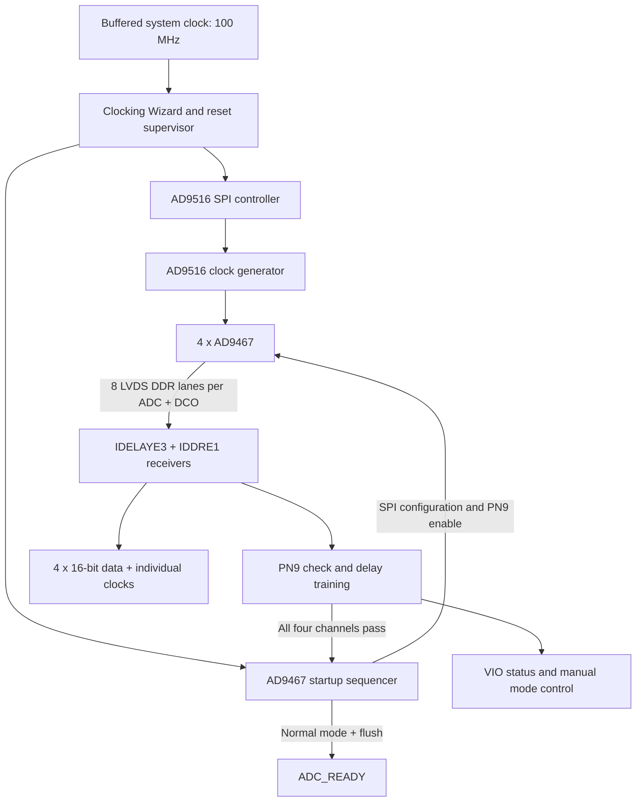

# AD9467 FPGA Interface — SPI, PN9 Training & AD9516 Clock Setup

**Four-channel ADC bring-up, clock configuration and digital receive-path calibration in VHDL.**

[Ramin Chegini](https://github.com/ramin-chegini)

This project demonstrates FPGA-based bring-up of four **AD9467** ADCs and an **AD9516** clock generator. It covers SPI register programming, LVDS DDR data capture, **PN9** sequence checking and automatic input-delay calibration. The startup sequence runs in FPGA logic without an external processor.

The current top-level module, `ADC_orihard`, provides four raw 16-bit data outputs with their individual ADC clocks. Earlier design versions and supporting blocks are identified in the [HDL source guide](HDL/README.md).

## Engineering highlights

| Area | Implementation |
|---|---|
| Device bring-up | Reset sequencing, clock readiness checks and register configuration |
| SPI control | 24-bit frames, MSB-first transmission and CS/SCLK sequencing |
| DDR capture | Eight LVDS data lanes per ADC reconstructed into 16-bit words using `IDDRE1` |
| PN9 checking | Next-word prediction with rejection of corrupt data and stuck inputs |
| Calibration | Six reconstruction modes and midpoint selection within a valid delay window |
| Lane deskew | Independent lane-delay adjustment when a common delay window cannot be found |
| Clock-domain crossings | Status synchronization and local synchronous reset release |
| Fault handling | Training timeout and readiness held low when startup fails |
| Existing verification sources | Assertion-based testbenches covering normal operation and fault cases |

## Architecture



Each receiver captures and trains using its own ADC DCO. Calibration validates word reconstruction within each receiver; deterministic sample alignment between the four ADCs requires additional system-level handling.

## Repository layout

```text
AD9467/
├── README.md                       # Project overview and usage
├── docs/
│   └── BRINGUP.md                  # Integration and bring-up guide
├── HDL/
│   ├── README.md                   # Active sources and earlier versions
│   ├── ADC_orihard.vhd             # Top-level interface and four receivers
│   ├── M_AD9516_Ctrl.vhd           # Clock-generator SPI configuration
│   ├── ad9467_startup.vhd          # ADC configuration and startup sequence
│   ├── adc_training_pkg.vhd        # PN9 and word-reconstruction functions
│   ├── adc_pn9_trainer.vhd         # Common-delay training and lane deskew
│   ├── adc_idelay_loader.vhd       # Input-delay update control
│   ├── ADC_ALIGN_VIO.md            # Calibration and VIO reference
│   └── tests/                     # Existing testbenches and scripts
├── Constraints/adc_align_cdc.xdc   # Clock-domain crossing constraints
├── IP/                            # Packaged IP from the original project
└── Prj/AD9467_ADC_Driver.xpr       # Original Vivado 2025.2 project
```

The repository keeps HDL sources, constraints, project metadata and packaged `.xcix` IP files. Generated Vivado caches, logs and build outputs are excluded through `.gitignore`.

## Startup sequence

1. A supervisor runs from the incoming 100 MHz clock so it can reset the MMCM even when the MMCM output clocks stop.
2. Internal clocks are generated. `IDELAYE3` reset releases before `IDELAYCTRL` reset, and application logic waits for delay-controller readiness.
3. The AD9516 controller sends its board-specific sequence of 63 register writes. The register profile depends on the board and the exact AD9516 variant.
4. Once the required clocks, delay controller and AD9516 lock are ready, the ADC sequencer waits 100 ms with the default parameters and broadcasts the ADC configuration.
5. All ADCs enter PN9 mode. Each receiver independently searches for a valid reconstruction mode and input delay.
6. After all four receivers pass, the ADCs return to normal conversion with two's-complement output. `ADC_READY` asserts after a further 2048 control-clock cycles to drain the transition samples.

`clk_25m` and `S6_25MCLK` are legacy names: their actual frequency in this design is **20 MHz**. The Clocking Wizard also requests 100 MHz, 200 MHz and approximately 333.333 MHz outputs. Its generated 100 MHz output is unused in the current top-level module.

## SPI programming

Each active controller sends a **16-bit instruction/address followed by an 8-bit data byte**. The AD9467 sequencer uses SPI Mode 0, with a default SCLK frequency of 2.5 MHz from the 20 MHz control clock. The four ADC SPI interfaces receive identical commands in parallel.

| Device | Register | Value | Purpose in this design |
|---|---|---|---|
| AD9467 | `0x14` | `0x08` | Select offset-binary output for training |
| AD9467 | `0x0D` | `0x06` | Enable PN9 output |
| AD9467 | `0xFF` | `0x01` | Apply ADC register changes |
| AD9467 | `0x0D` | `0x00` | Disable the test pattern |
| AD9467 | `0x14` | `0x09` | Select two's complement for normal acquisition |
| AD9516 | `0x0232` | `0x01` | Apply buffered settings through IO_UPDATE |

The complete ADC command tables are in `ad9467_startup.vhd`; the clock-generator table is in `M_AD9516_Ctrl.vhd`. Both active controllers perform register writes. Register readback is not implemented in this path.

PN9 selection and ADC output formatting are documented in the [AD9467 datasheet](https://www.analog.com/media/en/technical-documentation/data-sheets/AD9467.pdf). The [AD9516-0 datasheet](https://www.analog.com/media/en/technical-documentation/data-sheets/ad9516-0.pdf) describes the family serial interface and IO_UPDATE mechanism. Use the datasheet for the exact device fitted to the board when changing the clock profile.

## PN9 checking and delay training

`pn9_next` uses the `x^9 + x^5 + 1` recurrence and the ADC output formatting to predict the next 16-bit word. The receiver compares the prediction with incoming data without requiring a fixed starting PN phase. The existing testbench also checks the datasheet reference sequence:

```text
FFFF → 87BE → AE64 → 929D
```

The common-delay search evaluates six DDR reconstruction modes at delays `0, 8, …, 504`. After settling at each candidate, it requires 32 consecutive correct words for sequence acquisition, followed by 1024 correct words for candidate acceptance. A valid window must contain at least four passing points. The midpoint of the longest passing window is selected.

If the eight lanes have no valid shared window, `adc_lane_pn9_trainer` finds a reliable reference lane, reconstructs the PN state from nine observations and searches the delay window of each lane independently. A final full-word comparison checks that all lanes agree.

`adc_idelay_loader` controls EN_VTC guard intervals and limits each LOAD update to at most eight taps. After VTC is restored, 4096 correct words are required for final acceptance. Constant inputs and the forbidden PN state, represented as `0x8000` in the selected format, are rejected.

## Opening the project

The saved project targets **`xcvu9p-flga2104-2-i`** and records **Vivado 2025.2** as its tool version:

```text
Prj/AD9467_ADC_Driver.xpr
```

The active source set contains the six VHDL files listed in the [HDL source guide](HDL/README.md), the clock and VIO IP, and the constraint file under `Constraints/`. Check IP compatibility in Vivado when using a different tool version. See the [bring-up guide](docs/BRINGUP.md) for integration details.

Board-specific pin assignments, I/O standards, clock constraints and ADC input-delay constraints must be supplied before building a board bitstream. The included CDC constraints alone do not define a complete board implementation.

## Existing testbenches

The repository includes the following verification sources:

| Testbench | Coverage |
|---|---|
| `tb_adc_training` | Six DDR modes, eye centering, delay steps, APPLY, stuck data and final VTC verification |
| `tb_adc_lane_training` | PN-state recovery, separate lane eyes, shared-eye path and lane fault rejection |
| `tb_ad9467_startup` | ADC SPI frames, PN9/normal command order, all-channel barrier and timeout |
| `tb_adc_clock_supervisor` | Clock lock, IDELAY readiness and recovery after clock loss |
| `tb_adc_delay_reset` | Reset-release ordering and stopped-clock behavior |

To run the existing suite from a Vivado Command Prompt at the repository root:

```bat
HDL\tests\run_tests.bat
```

Its success marker is `ADC_AUTOSTART_TESTS_PASSED`. The legacy `HDL/tests/synth_check.tcl` refers to an earlier `ADC_xung` integration and cannot run directly against the current top. Use `AD9467_ADC_Driver.xpr` for synthesis of the current interface.

## Outputs and diagnostics

- `ADC1_DATA` through `ADC4_DATA`: 16-bit samples, each in its corresponding `ADCx_CLK` domain.
- `ADC_READY`: startup has passed and the PN9-to-normal transition has completed. Synchronize this signal in the consuming clock domain.
- `ADC_TRAIN_FAILED`: the startup sequence has entered a fault state. Reset starts another calibration attempt.
- `CLOCK_LOCKED` and `IDELAY_READY`: synchronized status in the incoming 100 MHz clock domain.
- `vio_adc_align`: per-channel status and optional manual reconstruction-mode control after startup.

Raw outputs also change during training. Treat them as normal samples only after `ADC_READY`. Moving samples into another clock domain requires an appropriate interface, such as a dual-clock FIFO. The [VIO reference](HDL/ADC_ALIGN_VIO.md) describes the status fields and manual controls.

## Scope of the results

A successful PN9 check provides evidence of digital receive-path correctness under the test conditions. It does not measure SNR, ENOB, long-term error rate or board timing margin. PN9 checking runs during startup and is not continuous in normal acquisition mode.

Simulation and synthesis do not replace board measurements or timing analysis after routing. Hardware captures, timing reports and measured results can be added to document the conditions under which the design has been demonstrated.
